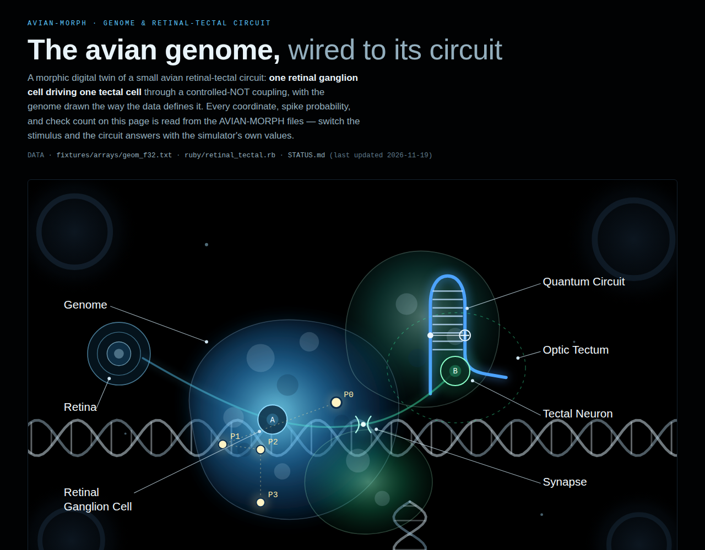

# AVIAN-MORPH


**Topics:** `avian` `neurogenomics` `quantum` `vulkan` `spir-v` `cbqn` `c11` `openqasm` `digital-twin` `retina` `tectum` `array-programming` `genomics` `systems-engineering` `open-source`

**AVIAN-MORPH is the Sovereign Morphic Avian Neurogenomic Quantum Array Engine.** It models a small avian retinal-tectal circuit as a morphic digital twin: one retinal ganglion cell driving one tectal cell through a controlled-NOT coupling, with the genome drawn the way the data defines it. Biological avian neurons are the reference system, and quantum circuits are their computational counterparts. The engine does not claim that real bird neurons are quantum computers. It uses the bird visual system as the biological reference and builds a verified computational model of it.



*The AVIAN-MORPH genome front end. The genome, the retina, the retinal ganglion cell, the optic tectum, the tectal neuron, the quantum circuit, and the synapse are drawn on a dark field in glowing blue and green, the way a Cas9 genome diagram draws its parts. Every coordinate, spike probability, and check count on the page comes from the AVIAN-MORPH files.*

## What AVIAN-MORPH is

AVIAN-MORPH is an engine, not a model card and not a demo. It takes a biological reference system — the avian retinal-tectal circuit, the pathway that carries visual information from the retina to the optic tectum — and it builds that circuit as a stack of verified layers. Each layer owns one concern, each layer speaks one language, and each layer is checked against the layer below it by execution.

The engine starts from the genome. Genomic coordinates define positions in space, and a 3D affine transform maps those coordinates onto the circuit. The retinal ganglion cell reads the stimulus. The tectal cell answers through a controlled-NOT coupling. The quantum circuit is the computational counterpart of that coupling: a 6-qubit circuit with one neuron on qubits 0–2, a coupling on qubits 2–3, and a second neuron on qubits 3–5. The numerical kernels that move the data — scale, convolution, reduction, gather and scatter, coordinate transform, complex rotation, normalization — are written once in CBQN as the reference semantics, once in C11 as the kernel ABI, and once in Vulkan as SPIR-V compute shaders. The invariant across those three writings is the spine of the whole project:

```
K_CBQN(x) == K_C(x) == K_Vulkan(x)
```

The CBQN reference, the C kernel, and the Vulkan shader compute the same function. The first equality is verified by execution: CBQN regenerates the fixtures on every test run, and the C kernel is compared against the fresh CBQN result, bit-exact, on every fixture. The second equality is asserted by construction and awaits a GPU: the shaders compile to SPIR-V and pass spirv-val validation, and the disassembly confirms the expected arithmetic, but no GPU is present on this machine, so no shader executes here.

The engine is deterministic. Every kernel validates first and computes second, so a failed call writes nothing. Every accumulation runs in a fixed order. Every fixture uses exactly representable values, so the CBQN-to-C comparison is bit-exact and needs no tolerance. The test suites run twice from a clean tree and give identical results both times. The total across the seven C11 kernel families is 4304 checks, 0 failures.

The engine is also honest about what it does not do. SAW and Cryptol are not installed, so no proof is claimed. q, Self, and Mercury are not installed; those layers are recorded as missing toolchains, not substituted. Vulkan execution and CPU-vs-GPU conformance are unverified because there is no GPU. The verification record lives in `verification/VERIFICATION_STATUS.md`, and it lists every layer as verified or unverified, with the reason.

## The front end

AVIAN-MORPH has a front end. It is a Muse space, slug `avian-morph-genome`, and it looks like a Cas9 genome diagram: a black page, a glowing translucent blue-green genome, DNA helices, a quantum-circuit loop with a CNOT mark, and a retina-to-tectum neural pathway, with labels and thin leader lines pointing to each part. The front end is connected to the real data. Every coordinate, spike probability, and check count on the page is read from the AVIAN-MORPH files. The photos in this README are screenshots of that front end.

The hero visualization draws the genome the way the data defines it. Four genome points are plotted from the geometry fixture, and selecting a point shows its input-to-output mapping. The retina feeds the retinal ganglion cell, neuron A. Neuron A drives the tectal neuron, neuron B, through the controlled-NOT coupling. The synapse is the retinal-to-tectal projection between them. The quantum circuit loop sits over the optic tectum and carries the CNOT mark that couples the two neurons.


*The Bright stimulus state. The stimulus angle is pi, neuron A spikes at 1.0, neuron B spikes at 1.0, and the pathway between them is lit. The same page in the Dark state shows both neurons silent at 0.0, and in the Dim state both graded at 0.5.*

The front end carries a stimulus switch with three conditions: Dark, Dim, and Bright. Switching the stimulus replays the simulator's own values. Dark sets the retinal input angle to 0 and both neurons read silent at 0.0. Dim sets the angle to pi/2 and both neurons read graded at 0.5. Bright sets the angle to pi and both neurons read spiking at 1.0. The neuron glow, the pathway lighting, and the probability bars all update to match. The genome parameters sit alongside: the phase angles are 0.0, and the second neuron's input angle is 0.0.

Below the visualization, the front end shows the genome coordinates table: the 3x3 matrix, the translation vector, and the four points with their input and transformed output. Below that, it shows the kernel verification table: all seven C11 kernel families with their real check counts, totaling 4304 checks and 0 failures, plus the eight Vulkan shaders, all SPIR-V valid. Nothing on the page is invented. The page reads the files, and the files are the evidence.

## Architecture by language layer

The architecture assigns one language to each layer, and no language substitutes for another. The assignment is fixed.

**Self holds the morphic organism model.** Prototype neurons, delegation, adaptive morphology, and object identity live here. Each neuron is a Self prototype that preserves biological identity, morphology, connectivity, and developmental state. The Self toolchain is not installed on this machine, so this layer is recorded as a missing toolchain, not substituted.

**Ruby holds morphic composition and orchestration.** Neuron assemblies, metaprogramming, and developmental transformations live here. Ruby orchestrates the pipeline through defined interfaces. The retinal-tectal orchestrator, `ruby/retinal_tectal.rb`, is the working proof of this layer: it generates the OpenQASM circuits, drives the reference simulator, and reports the three stimulus conditions.

**q holds genomic geometry.** Genomic coordinate maps, spatial indexing, adjacency tensors, and geometric transformations live here. q is commercial and is not installed on this machine, so no q code runs here. The genome stands in as a plain Ruby parameter hash for the milestone only, and the coordinate transform itself is implemented and verified in CBQN, C11, and Vulkan. The boundary is documented in `q/BOUNDARY.md`.

**CBQN holds array algebra and kernel reference semantics.** Rank-polymorphic operations, reductions, scans, permutations, and tensor reference algorithms live here. CBQN is the reference oracle. Every C kernel is compared against a CBQN implementation, and CBQN regenerates the fixtures on every test run, so the comparison is always against a fresh oracle result.

**C11 holds the kernel ABI.** Shapes, strides, buffer ownership, and numerical representations live here. The C kernel consumes validated buffer descriptions only. All numerical kernels originate from explicit array semantics in q and CBQN. The C11 layer is the one that runs: seven kernel families, 4304 checks, 0 failures.

**LLVM IR with SAW and Cryptol holds machine-level contracts.** Equivalence proofs, bounds, and arithmetic live here. SAW verifies supported LLVM representations against formal specifications, and Cryptol holds the bit-vector specs. Neither toolchain is installed on this machine, so no proof is claimed for this layer.

**Vulkan holds the compute backend.** SPIR-V compute shaders run on GPU buffers. There is no CUDA anywhere in this project. Vulkan is an acceleration backend, not a dependency for running the biological model. CPU-only builds do not require an installed Vulkan GPU. The shaders are validated here — compiled to SPIR-V and checked with spirv-val — and they await a GPU for execution.

**Mercury holds symbolic quantum gate intelligence.** A typed circuit AST, gate rules, constraints, and deterministic validation live here. Mercury controls circuit semantics with a typed gate IR. The Mercury compiler is not installed on this machine, so no typed gate IR validation runs here; the circuits are validated by the reference simulator instead.

**OpenQASM 3 holds the resulting quantum circuits.** Parameterized gates, entangling operations, measurement, and feedback live here. The circuits are `openqasm/neuron_3q.qasm` and `openqasm/retinal_pair.qasm`, and they run under the C11 reference simulator in `openqasm/sim/`.

No JavaScript, TypeScript, Python, React, PyTorch, NumPy, TensorFlow, or CUDA appears in the numerical kernel path. The kernel path is CBQN, C11, and Vulkan, and that is the whole of it.

## The C11 kernel families

Seven kernel families make up the C11 layer. Each family carries its own header, its own implementation, its own test program, and its own numerical contract in `src/c11/`. Each family validates first and computes second, in the same check order: NULL, COUNT, OVERLAP, NONFINITE. A failed call writes nothing. There is no allocation anywhere in the kernels.

### Scale — 1055 checks
### Receptive-field convolution — 1069 checks
### Segmented reduction — 71 checks
### Sparse gather and scatter — 1212 checks
### Genomic coordinate transform — 407 checks
### Complex rotation — 300 checks
### L2 normalization — 190 checks

See `src/c11/CONTRACT*.md` for the full numerical contracts. CBQN regenerates fixtures on every test run; bit-exact on fixtures.

## The invariant

```
K_CBQN(x) == K_C(x) == K_Vulkan(x)
```

CBQN vs C is verified by execution (4304 checks, 0 failures). Vulkan is validated as SPIR-V (8 shaders); GPU execution awaits hardware.

## How to run

```sh
make -C src/c11 test
make -C vulkan/shaders test
make -C openqasm/sim test
ruby ruby/retinal_tectal.rb
```

## License

AVIAN-MORPH uses the SNAPKITTY OPAQUE SOURCE LICENSE v1.0. Commercial exploitation needs separate written authorization; publication, access, download, visibility, or possession is not that authorization.
